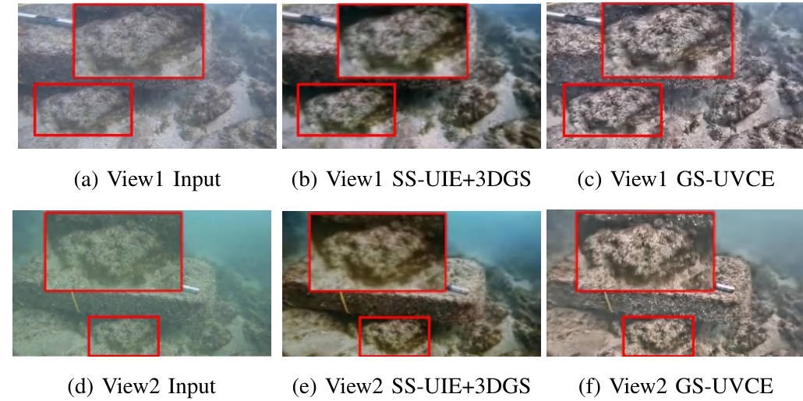
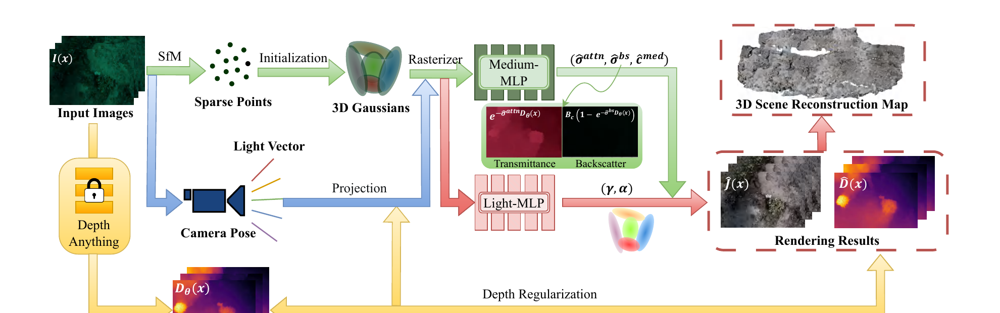

<div align="center">

# GS-UVCE

### Gaussian Splatting-Driven Unsupervised Visual Consistency Enhancement for Underwater 3D Scene Reconstruction

<p>
  
  
  
</p>

<p>
  <a href="https://github.com/CharlyX-Lee"><strong>Xiang Li</strong></a><sup>1</sup>
  &nbsp;&nbsp; Chi Li<sup>2</sup>
  &nbsp;&nbsp; Yiming Xu<sup>3</sup>
  &nbsp;&nbsp; <a href="https://scholar.google.com/citations?user=y8Z43QcAAAAJ&hl=en&oi=ao"><strong>Yan Zhuang</strong></a><sup>4*</sup>
</p>

<p>
  <sup>1</sup>School of Computer Science and Technology, Dalian University of Technology<br />
  <sup>2</sup>School of Information Engineering, Dalian University<br />
  <sup>3</sup>International School of Information Science and Engineering, Dalian University of Technology<br />
  <sup>4</sup>School of Control Science and Engineering, Dalian University of Technology
</p>
<p><sup>*</sup>Corresponding author</p>

<p>
  <strong>IEEE International Conference on Robotics and Automation (ICRA), 2026</strong>
</p>

</div>

<p align="center">
  
</p>

<p align="center">
  <em>GS-UVCE jointly improves underwater appearance and reconstruction consistency across views, avoiding the illumination mismatch introduced by independently enhanced inputs.</em>
</p>

## Overview

Underwater 3D scene reconstruction is challenged by scattering, attenuation, color cast, low illumination, and view-dependent appearance changes. Existing pipelines commonly enhance each image independently before reconstruction, which can yield visually inconsistent multi-view inputs and unstable geometry.

**GS-UVCE** is an end-to-end Gaussian Splatting-driven framework that unifies unsupervised visual consistency enhancement and underwater 3D reconstruction. It explicitly models the water medium, adaptively corrects illumination, and applies depth regularization during scene optimization. The result is a coherent scene representation that preserves both underwater appearance and geometric structure across viewpoints.

## Key Contributions

- **Joint enhancement and reconstruction.** GS-UVCE unifies unsupervised underwater visual consistency enhancement with 3D Gaussian Splatting for high-fidelity scene reconstruction.
- **Medium-aware rendering.** A **Medium-MLP** estimates attenuation, backscatter, and medium color to account for underwater optical effects.
- **View-consistent illumination.** A **Light-MLP** models viewpoint-dependent illumination and adaptively corrects light while preserving the modeled medium.
- **Geometry-preserving optimization.** Depth supervision from Depth Anything and edge-aware depth regularization stabilize local scene structure in degraded underwater imagery.

## Method

<p align="center">
  
</p>

GS-UVCE initializes 3D Gaussians from an offline SfM pipeline and jointly optimizes the scene with a differentiable rasterizer. The Medium-MLP separates medium attenuation and backscatter from object appearance; the Light-MLP learns view-dependent illumination correction. Rendered depth is regularized against monocular depth estimates and smoothed away from object boundaries, encouraging reconstruction fidelity under challenging underwater conditions.

## Evaluation

The paper evaluates rendering quality on the **SeaThru-NeRF** benchmark across Curacao, IUI3-RedSea, JapaneseGardens-RedSea, and Panama scenes. Underwater enhancement and rendering behavior are further evaluated on **DRUVA**, **RUIE**, and SeaThru scenes.

Compared with prior underwater reconstruction and image-enhancement pipelines, GS-UVCE improves the preservation of distant structures, suppresses color distortions and overexposure, and maintains illumination consistency across views. The paper includes quantitative comparisons using PSNR, SSIM, LPIPS, and rendering speed, as well as ablations of the Medium-MLP, Light-MLP, and loss terms.

## Code Availability

The implementation, training configurations, evaluation scripts, and pretrained checkpoints are being prepared for public release. This repository currently serves as the official project page for the paper.

Please watch this repository for updates. Until release, no source code, model weights, or private datasets are distributed here.

## Citation

If you find this work useful, please cite:

```bibtex
@inproceedings{li2026gsuvce,
  title        = {{GS-UVCE}: Gaussian Splatting-Driven Unsupervised Visual Consistency Enhancement for Underwater 3D Scene Reconstruction},
  author       = {Li, Xiang and Li, Chi and Xu, Yiming and Zhuang, Yan},
  booktitle    = {2026 IEEE International Conference on Robotics and Automation (ICRA)},
  pages        = {4920--4927},
  year         = {2026},
  publisher    = {IEEE},
  doi          = {10.1109/ICRA57385.2026.11696993}
}
```

## Acknowledgements

This work builds on [3D Gaussian Splatting](https://repo-sam.inria.fr/fungraph/3d-gaussian-splatting/), [Nerfstudio](https://nerf.studio/), and [Depth Anything V2](https://github.com/DepthAnything/Depth-Anything-V2). We thank the authors and maintainers of these projects for making their work available to the research community.

## License

The code is not yet publicly released. The license for the implementation will be announced with the code release.
